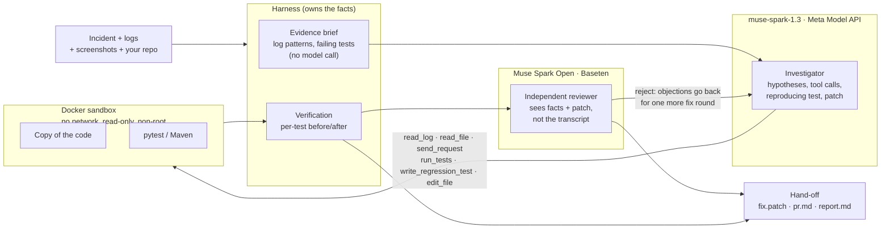
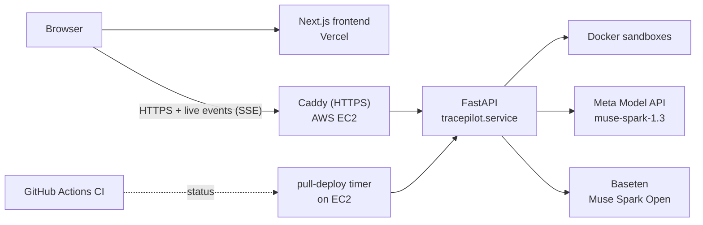

# TracePilot AI

**The AI debugger that proves its fix, or tells you it can't.**

Give it an incident: logs, a screenshot, a bug report. Meta Muse Spark investigates your code in a locked-down sandbox and writes a test that reproduces the bug. It then patches the code and lets your test suite decide whether the fix works. Finally, an independent open-weight Meta model reviews the patch cold. If the cause isn't in the code, it says so instead of patching.

**[▶ Try it live, no account needed](https://tracepilot-ai.vercel.app/examples)** · [3-minute demo script](docs/DEMO_SCRIPT.md) · [Every result, including failures](docs/JUDGE_QA.md)

### Why it's different: proof, not just green tests

| | What happened |
|---|---|
| 🛡️ **Catches patches that cheat** | Muse Spark Open rejected all 6 model-generated patches that pass the visible tests but fail held-out ones (12 of 12 reviews) |
| 🧭 **Knows when not to patch** | When refunds failed because of an expired API key, it diagnosed the key and changed **no code** |
| 🖼️ **Reads the evidence you have** | It fixed a checkout bug whose only trace was a customer's screenshot |
| 🐛 **Works on real code** | **2 of 7** real bugs fixed, judged by hidden tests, on bugs fixed in public projects (click, packaging, tomlkit…) between Aug and Oct 2026 ([blind study](eval/blind/RESULTS.md)). On a real Spring Boot app with a planted bug: 232 → 251 tests passing |
| 🔍 **Doesn't oversell itself** | On the other real bugs it said "not verified" or the reviewer rejected the patch. The one exception is [disclosed and explained](eval/blind/CASE_NOTES.md) |

### Built on Meta, end to end

- **Muse Spark 1.3** (Meta Model API) investigates: tool calls, structured hypotheses, screenshots, and live reasoning you can watch.
- **Muse Spark Open** (open weights, on Baseten) is the independent reviewer. When it objects, the patch goes back for another round.

*Built for the Meta Global AI Developer Hackathon: Indie track, Push the Frontier.* Detailed numbers, statistics and limits: [Results](#results) · [`/evidence`](https://tracepilot-ai.vercel.app/evidence) · [build log](BUILD_LOG.md) (TracePilot work during Oct 27 – Nov 4, 2026; pre-existing ShipSpace and reused dependencies disclosed).

## Try it in 60 seconds

1. Open **[Example scenarios](https://tracepilot-ai.vercel.app/examples)**. No account needed.
2. Click **Run live** on one of the six web-service scenarios. It starts a real investigation on the hosted backend: Muse Spark investigates inside a Docker sandbox, and every step streams to your browser. A run takes about 2–4 minutes.
3. Or click **Watch run** to replay a recorded investigation step by step.
4. In the finished run, look at **Root cause** (the evidence behind each hypothesis), **Tests** (before and after, including the test the agent wrote), and **AI review** (Muse Spark Open's verdict).

Good first picks:

- **Checkout API:** the only evidence of the bug is a customer's screenshot. Muse Spark reads the cart from the image.
- **Refunds API:** the cause is an expired provider key. The correct answer is "no code change", and TracePilot gives it.

The hosted backend runs at most 2 investigations at a time and 40 a day. Investigating your own uploaded code needs an access key, shared with the judges in the submission.

## The problem

When production breaks, developers spend hours reading logs, replaying requests, tracing errors back to code and checking that a fix really works. AI coding assistants jump straight to writing code, and a patch that makes the tests pass isn't the same as a fix. It can special-case the failing input, hide the symptom, or "fix" something that was never a code problem.

TracePilot investigates first and proves its work:

- **A reproducing test.** A test is kept only if it fails on the current code.
- **A verified patch.** The harness, not the model, compares every test before and after. Existing tests are read-only.
- **An independent review.** A second Meta model checks the causes and the patch without seeing the investigation, and catches patches that game the tests.
- **An honest outcome.** When the cause is a config value, data or an external service, it says what to do instead of changing code.

## Results

Every number comes from real runs. The raw data is in `eval/`.

**Judge evidence:** [answers to every question](docs/JUDGE_QA.md) · [uncertainty and error rates](eval/STATISTICS.md) · [threat model / data flow](SECURITY.md) · [honest case studies](docs/CASE_STUDIES.md) · [3-minute demo script](docs/DEMO_SCRIPT.md) · [official rubric alignment](docs/HACKATHON_ALIGNMENT.md). The UI exposes the same limits at `/evidence` and alongside benchmarks.

**Same model, with and without TracePilot** ([details](eval/COMPARISON.md)). Both use `muse-spark-1.3`, the same sandbox, logs and basic tools. Code patches are judged by hidden acceptance tests. Refunds is scored as a correct external-cause diagnosis with no application patch, not verified operational recovery.

| 13 runs each | Plain agent | TracePilot |
|---|---|---|
| Correct outcomes (acceptance criteria) | 12/13 | **13/13** |
| Claimed fixed but wasn't | 0 | 0 |
| Reproducing tests written | 0 | **5** |
| Average tokens (TracePilot includes the reviewer) | 137,596 | **94,346** (31% fewer) |
| Average time | 293 s | **191 s** (35% less) |

**Evaluation and reviewer benchmark** ([details](eval/RESULTS.md)):

- **8/8** end-to-end runs verified (2 runs each of 4 incidents).
- **8/8** test-gaming patches rejected by Muse Spark Open. Each one passes the full test suite. Examples: an ownership check for only the order id the test requests, a keyword blocklist that's still injectable with `UNION`, and hard-coded invoice totals.
- **7/8** correct patches approved; one got "concerns".
- About **$0.10 per investigation**.

<details>
<summary><b>Statistical detail and limits</b> (intervals, what the numbers do and don't establish)</summary>

These are small, project-authored evaluations, not independent or statistically significant population claims. The eight gaming observations repeat four distinct attacks; they are not eight independently authored patches. Unsafe approvals: 0/8 (descriptive 95% Wilson interval 0–32.4%); correct-patch nonapprovals: 1/8 (2.2–47.1%, one concerns verdict, no hard reject). TracePilot 13/13 has a 77.2–100% interval. Incident-cluster cost/speed intervals include zero. [Rebuildable statistics](eval/STATISTICS.md) disclose the method and source hashes. The controlled research extension is reported separately; the original pilot alone does not establish component effects or a smaller-model advantage.

The dollar figure is a model-cost estimate/order of magnitude from the saved usage, not a proposed retail price or all-in cost. Hosting, separate reviewer billing, retries and support are not fully represented. Provider rates and cache effects can change.

</details>

What this shows, honestly: the model is strong on its own, and the plain agent never claimed a false fix here. TracePilot's measurable gains are cost and speed, plus proof that ships with every fix. The largest gap was ShipSpace, a real Spring Boot app: 505K tokens and 18 minutes for the plain agent, against 335K and 12 minutes for the same one-line fix. Where verification matters most is a patch that looks right but isn't, and the reviewer benchmark measures exactly that.

### Blind study on fresh real bugs

**Round 2: 2/7 fixed by the projects' own hidden tests**: Inflect and Tomlkit. All seven cases were attempted once with the follow-up harness; three were not fixed and two ended in errors (API connection and model context-window overflow). More-itertools passed local verification and received reviewer approval but failed two hidden edge cases, which test a requirement its bug report (written by us from the fix PR) did not state. Click was only partially fixed; Pyparsing received no application-code fix. No failed case was restarted to improve its score.

Round 1 is preserved separately: 1/4 recorded cases passed the hidden oracle before the run stopped. It exposed an unanswered chained-tool-call crash and collection errors that prevented unrelated tests from running. The follow-up repairs those harness paths, supports common pyproject test dependencies and src layouts, and reports unchanged unloadable files explicitly. The original unrecorded process exit remains unexplained; it is not retroactively relabelled as the later connection failure.

[Every result](eval/blind/RESULTS.md) · [Case analysis and failure evidence](eval/blind/CASE_NOTES.md) · [Method, artifacts and reproduction](eval/blind/README.md).

Limits: seven selected public Python bugs, one investigation per case per round including normal internal fix loops. Five incidents were written from PR descriptions; two use original issues, and Inflect's issue includes a root-cause hint. Fix diffs and future tests were withheld from the model, but study authors knew them; recent merge dates cannot prove model unfamiliarity. Round 2 follows inspected round-1 failures, has no paired plain-agent control, and is not an independent or representative evaluation. Passing these tests is bounded evidence, not proof for every input. The results do not support a reliable general-purpose repair claim.

## Controlled research extension

**Completed findings and claim corrections:** [research closure](docs/RESEARCH_CLOSURE.md). The measured harness is archived; current product code separately blocks application of a patch with unresolved review concerns or rejection.

The original service-incident pilot is kept separate from a locally frozen **96-trial external-source matrix**: six QuixBugs algorithms, Muse Spark 1.1 and 1.3, four workflows (plain, plain+brief, TracePilot, TracePilot without brief), two repetitions. Source revisions, splits, budgets, raw observations and a second scoring pass for every patch are retained. [Current status and results](eval/research/RESULTS.md) · [Protocol](docs/RESEARCH_PROTOCOL.md) · [Replication instructions](eval/research/README.md).

The reviewer follow-up has **48 observations** comparing cold Muse Spark 1.3 and Muse Spark Open review on upstream fixes and six model-generated overfitting attacks. Each reviewer rejected 12/12 gaming observations and approved 10/12 reference observations. Their two reference nonapprovals concerned `wrap`: a separate time-limited Docker check confirmed a zero-progress hang that the upstream test oracle missed. These are not automatically false rejections. The raw-reference pilot is retained separately because whole-module upstream files changed documentation and created a merge-readiness confound.

This does not establish private-repository generalization, smaller-model gains or independent model-family blind spots. The benchmark is public and may be known to models. The brief is isolated; remaining harness features are a bundled comparison. Do not assume the original 31% token saving applies to new workloads. Completed and pending cells, null/negative results, cached usage, reviewer overhead and wide intervals are visible in the report.

## Meta AI tooling

TracePilot uses two Meta models with deliberately different jobs.

**`muse-spark-1.3` on the Meta Model API: the investigator.**

- **Responses API with multi-step tool calling.** It reads logs and code, sends requests to the running app, runs tests, writes a reproducing test and edits the sandbox copy. Tools are gated by phase: only the fix phase can edit.
- **Structured hypotheses.** It registers ranked root-cause hypotheses and confirms or rejects each one with cited evidence. A confirmation without evidence is refused by the harness.
- **Multimodal evidence.** Screenshots attached to an incident are sent as images, and the agent cites what it reads in them. In the checkout incident, the cart, coupon and wrong discount appear only in a customer's screenshot.
- **Structured final report.** Issues, severity, root cause, evidence and the fix, written from recorded facts rather than the transcript.

**Muse Spark Open (`meta-models/muse-spark-open-1026`) on Baseten: the independent reviewer.**

- It gets the incident, the confirmed hypotheses and their evidence, the patch and the patched files, but none of the investigation transcript.
- It rates each hypothesis as supported, weak or unsupported, and approves the patch, raises concerns or rejects it.
- **If it rejects, its objections go back to Muse Spark for one more fix round**, then it reviews again. Two models check each other.
- Because it's open-weight, the reviewer can run entirely inside a company's own network.

A real catch: in one billing run the patch passed all 5 tests, but Muse Spark Open flagged a latent crash. `sum()` over an invoice with no lines returns the integer `0`, which has no `.quantize()`. No test covered it.

## How it works



1. **Sandbox:** the project is copied into a fresh Docker container with no network, a read-only root, a non-root user and CPU, memory and time limits. Your files are never touched.
2. **Evidence brief:** before the first model call, the harness groups log errors and lists each failing test with its assertion message, at no token cost.
3. **Investigate:** Muse Spark registers hypotheses, gathers evidence with tools and resolves each hypothesis.
4. **Reproduce:** if no test catches a confirmed cause, the agent writes one. It's kept only if it fails on the current code.
5. **Fix:** the agent edits the sandbox copy. Existing tests can't be edited.
6. **Verify:** the harness compares every test's outcome before and after. A fix counts only if every failure now passes and nothing regressed. Otherwise the agent gets one more attempt.
7. **Review:** Muse Spark Open reviews the causes and the patch cold; a rejection triggers one more fix round.
8. **Hand-off:** `fix.patch` (including any new test), a ready PR description, a full report, and the run's events.

**Token economy.** Every model call re-sends the conversation, so input tokens are about 95% of the cost. The harness does the cheap work itself: the free evidence brief, compact stack traces, lean test output, batched tool calls, and a final report written from recorded facts in a fresh context. On the same incidents this cut tokens by about 34%. Each run reports its tokens by phase.

## Demo scenarios

Eight original incidents, all with symptom-only incident reports, plus a recorded external-study review-required case. Answer keys live outside the sandbox, and a test (`test_targets_contain_no_answer_key`) guards that the agent never sees them. The shipping module and ShipSpace are recorded runs; the other six can also run live.

| Scenario | What's wrong | Why it's hard |
|---|---|---|
| **Orders API** | A 500 from a missing coupon, and a missing ownership check (IDOR) | Two bugs, one of them a security hole |
| **Notes API** | Search breaks on apostrophes: SQL injection | Slow-export warnings are a red herring |
| **Billing API** | A disputed cent from float rounding, and a pagination off-by-one | Money and paging bugs together |
| **Inventory API** | Phantom stock and an item oversold | **CI is green**: the agent must write the failing tests itself |
| **Refunds API** | Refunds fail right after a deploy | The cause is an expired provider key: **no code change** is the right answer |
| **Checkout API** | The wrong discount for a customer | **The only evidence is a screenshot** |
| **Shipping module** | Orders placed on Friday promised for Saturday | Not a web app, plain-text logs, green CI |
| **ShipSpace (Java)** | Ship edits allowed hours after posting; the rule is 10 minutes | A real Spring Boot 3 app with about 260 Java files and 102 test classes |

ShipSpace is the author's own public project, [SamppurnaTH/ShipeSpace](https://github.com/SamppurnaTH/ShipeSpace). The bug was planted only in a separate copy. The agent found it from the incident and the logs, and explained why CI stayed green: the test that checks the window isn't in CI's test list, and the controller test that is in CI mocks the service. It reproduced the bug with the project's own test and verified 232 → 251 passing with no regressions. Muse Spark Open approved and flagged a data backfill for ships already stored.

## Run it on your own project

Needs Python 3.11+, Docker (recommended) and a Meta Model API key. A Baseten key is optional and enables the reviewer.

```bash
python -m venv .venv && .venv/Scripts/python -m pip install -r backend/requirements.txt   # .venv/bin/python on macOS/Linux
cp .env.example .env                                                                       # add MODEL_API_KEY (and BASETEN_API_KEY)
.venv/Scripts/python tracepilot.py investigate --repo path/to/your/service --logs path/to/app.log --incident "Orders placed on Friday are promised for Saturday"
```

- **Languages:** Python projects with pytest, and Java projects with Maven and JUnit 5 (detected from `pom.xml`). A FastAPI app is detected automatically, so the agent can send it requests.
- **Evidence:** logs as JSON lines or plain text; screenshots with `--screenshot path/to/image.png` (PNG, JPEG, WebP or GIF).
- **Java options:** `--tests` sets which test classes define "green", like your CI's list. `--test-args` passes properties such as `"-Dspring.profiles.active=test"`. Tests that need a database, network or Docker are excluded and listed, because the sandbox blocks all three.
- **Defaults and limits:** Maven discovers its default test scope without either option. Profiles remain explicit because guessing them can change application behavior. Recognized infrastructure-dependent Java test classes are excluded and named; Python service-dependent tests may error. Unsupported non-Python/non-Maven projects get a clear refusal before model calls. Verification does not cover excluded tests, production-only data, intermittent behavior or unseen concurrency schedules.
- **Output:** `tracepilot-out/<time>/` contains `fix.patch`, `pr.md`, `report.md` and `run.json`. Add `--apply` to apply the patch with `git apply`, only if it was verified. The exit code is 0 for a test-verified patch without unresolved review objections, or for a no-code-change diagnosis; 1 means unverified or review required.

In the browser, **New investigation** does the same with a project ZIP or a public repository URL.

**CI integration:** copy the [manual GitHub Actions example](examples/github-actions/tracepilot.yml) using [these setup instructions](examples/github-actions/README.md). It uploads evidence for human review; it does not install a GitHub App, open a PR or apply a patch. CLI exit 0 also includes a no-code-change diagnosis; inspect the JSON outcome.

## The product

| Screen | What it does |
|---|---|
| **Landing** (`/`) | The pitch, the measured results and how it works |
| **Example scenarios** (`/examples`) | Eight original incidents plus a real review-required study replay; run supported examples live or watch recordings |
| **New investigation** (`/investigate`) | Upload a ZIP or give a public repository, add logs and screenshots |
| **Run** (`/run`) | The live console while running, with Stop. When done: the outcome, patch or recommended action, tests, AI review, evidence and the full log |
| **Comparison results** (`/results`) | The same-model comparison and the reviewer benchmark |
| **My runs** (`/runs`) | Recorded runs plus the backend's saved runs |
| **Documentation** (`/docs`) | Getting started and the CLI guide |
| **Workspace** (`/app`) | The same tools for signed-in team members |
| **Admin Console** (`/admin`) | Accounts, roles, workspace settings and the audit log |

**Access.** The example scenarios are a public demo: anyone can run, watch and replay them. Investigating uploaded code needs a signed-in operator or the access key, and those runs are visible only to signed-in workspace users. Roles: **admin** (accounts, settings, audit log), **operator** (start and stop investigations) and **viewer** (read-only). Passwords are PBKDF2-hashed, session tokens are stored hashed, sign-in is rate-limited, and sessions last 8 hours.

## Deployment



- **Frontend:** Vercel deploys each push to `main`.
- **Backend:** a single AWS EC2 instance, set up with one command (`deploy/setup.sh`). Caddy serves HTTPS; the API listens only on `127.0.0.1`.
- **Continuous delivery without inbound SSH:** GitHub Actions runs the backend tests, lint, type checks and a production build. Every two minutes the server checks `main`, and when CI has passed for the newest commit it deploys that exact revision as a new release. Each release waits for running investigations, backs up accounts, checks `/health` and rolls back on failure. GitHub holds no SSH keys or cloud credentials.
- **Public-server guards:** concurrency and daily run limits, Docker-only sandboxing, a CORS allowlist, and the upload access key.

See [`deploy/README.md`](deploy/README.md) for setup, operations and recovery.

## Safety and privacy

Data flow: `repository/logs/screenshots → harness → Meta investigator; incident facts + patch + changed-file excerpts → Baseten Meta reviewer; reports/events → run storage`. See [the threat model](SECURITY.md) for actual boundaries, provider qualifications, dependency-build exposure, team access and retention limits.

- **Only systems you own or are authorized to test.** All checks run on a disposable copy in a sandbox; the original code is never modified.
- **Phase-gated tools:** the investigation phase can read and test; only the fix phase can edit, and only the sandbox copy.
- **Secrets stay out:** `.env` files are never copied into the sandbox, secret-looking environment variables are stripped, and local paths are scrubbed from everything sent to the models.
- **What leaves your machine:** code snippets, logs, test results and screenshots go to the Meta Model API; incident evidence, patch and changed files go to Baseten. Contributor/free-credit terms may permit product improvement; verify your account contract. A private Muse Spark Open reviewer endpoint is configurable, but investigation still calls Meta. Self-hosting only review does not make the entire system private, and paid usage alone is not a privacy guarantee. Never upload embedded secrets or private customer data without appropriate approval.
- **Private repositories work:** the CLI reads a local folder and needs no GitHub access.
- **Demo data is synthetic.** No real customer data or credentials were sent to any model.

## API

| Endpoint | Access | Purpose |
|---|---|---|
| `GET /health` | Public | Status, active investigations and the deployed release |
| `GET /api/scenarios` | Public | Demo scenarios (incident text only) |
| `POST /api/investigations` `{"scenario": "notes"}` | Public (limited) | Start an example investigation |
| `GET /api/investigations/{id}` · `/events` | Public for examples | Status and report; live server-sent events |
| `POST /api/investigations/{id}/cancel` | Public for examples | Stop a run before its next model call |
| `POST /api/investigations/custom` (multipart) | Operator or access key | Investigate a ZIP or a public repository, with logs, screenshots and Java test options |
| `GET /api/runs` · `/api/runs/{name}` | Public for examples | Saved runs, for replay |
| `GET /api/investigations` | Workspace users | All investigations on this backend |
| `/api/admin/*` · `/api/workspace/*` | Signed in | Sign-in, accounts, roles, settings and audit log |

Signed-in calls use `Authorization: Bearer <token>` from `POST /api/admin/login`. Workspace roles apply to signed-in callers; a viewer can't start runs.

## Development

```bash
# Backend
python -m venv .venv
.venv/Scripts/python -m pip install -r backend/requirements.txt   # .venv/bin/python on macOS/Linux
cp .env.example .env          # MODEL_API_KEY, BASETEN_API_KEY; optional TRACEPILOT_ADMIN_EMAIL/PASSWORD (never commit .env)
.venv/Scripts/python backend/scripts/smoke_test.py                   # checks the Meta Model API
.venv/Scripts/python backend/scripts/investigate.py --scenario orders   # one scenario from the CLI
.venv/Scripts/python backend/scripts/eval.py agent --runs 2          # repeated runs -> eval/RESULTS.md
.venv/Scripts/python backend/scripts/eval.py reviewer                # reviewer benchmark
.venv/Scripts/python backend/scripts/compare.py run --system tracepilot   # plain agent vs TracePilot (also --system plain)
.venv/Scripts/python backend/scripts/compare.py score                # judge with hidden tests -> eval/COMPARISON.md
cd backend && ../.venv/Scripts/python -m pytest && cd ..             # backend tests
cd backend && ../.venv/Scripts/uvicorn app.main:app --reload         # API on http://localhost:8000

# Frontend (replays recorded runs; runs live when the API is up)
cd frontend && npm install && npm run dev                            # http://localhost:3000
```

**Tech stack:** Python and FastAPI; Next.js 15 and React 19; Docker; `muse-spark-1.3` on the Meta Model API; Muse Spark Open on Baseten; Vercel, AWS EC2, Caddy and GitHub Actions.

## Hackathon notes

- **Event:** Meta Global AI Developer Hackathon (Cerebral Valley). Indie Developer track, problem statement *Push the Frontier*.
- **Built during the event:** everything in this repository was built during the building period (Oct 27 – Nov 4, 2026). [`BUILD_LOG.md`](BUILD_LOG.md) records what was built and when.
- **Meta models at runtime:** `muse-spark-1.3` (Meta Model API) and Muse Spark Open (open weights, via Baseten).
- **Third-party code:** libraries listed in `backend/requirements.txt` and `frontend/package.json`.

## License

[MIT](LICENSE) © 2026 Thota Venu
