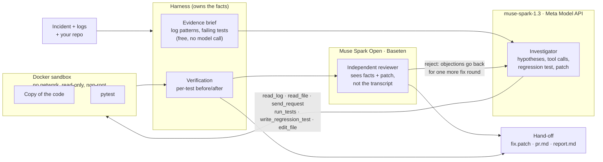

# TracePilot AI

**A verification-first debugging agent.** TracePilot turns a software incident into a test that reproduces it, a patch your test suite confirms, and a second opinion from an independent open-weight model, with the evidence to review before you merge. When the cause isn't in the code, it says so instead of patching. Built for the Meta Global AI Developer Hackathon (Indie Developer track, problem statement: Push the Frontier).

**Live demo: [tracepilot-ai.vercel.app](https://tracepilot-ai.vercel.app)** replays real, unedited investigations of five incidents.

**Results:**
- **[Same model, with and without TracePilot](eval/COMPARISON.md):** 13/13 actually fixed vs 12/13, with 31% fewer tokens and 35% less time.
- **[Evaluation](eval/RESULTS.md):** 8/8 runs verified and 8/8 test-gaming patches caught, at about $0.10 per investigation.

## Quickstart: run it on your own project

Needs Python 3.11+, Docker (recommended), and a Meta Model API key. A Baseten key is optional and enables the second opinion.

```bash
python -m venv .venv && .venv/Scripts/python -m pip install -r backend/requirements.txt   # .venv/bin/python on macOS/Linux
cp .env.example .env                                                                       # add MODEL_API_KEY (and BASETEN_API_KEY)
.venv/Scripts/python tracepilot.py investigate --repo path/to/your/service --logs path/to/app.log --incident "Orders placed on Friday are promised for Saturday"
```

It works on **Python projects with pytest** and **Java projects with Maven and JUnit 5**; the type is detected from `pom.xml`. Logs can be JSON lines or plain text. A FastAPI app is detected automatically, so the agent can also send requests to it.

For Java, two options match what your CI does:
- `--tests` sets which test classes define "green", such as the list your CI runs.
- `--test-args` passes extra properties, such as `"-Dspring.profiles.active=test"`.

Test classes that need a database, network or Docker (Testcontainers, embedded MongoDB, `@SpringBootTest`) are excluded and listed, because the sandbox blocks all three.

```bash
.venv/Scripts/python tracepilot.py investigate --repo path/to/spring-service --logs app.log \
  --tests "ShipControllerTest,UserServiceTest" --test-args "-Dspring.profiles.active=test" \
  --incident "Users can edit ships hours after posting; the rule is 10 minutes"
```

1. **Isolation:** the project is copied into a Docker sandbox with no network, a read-only root and a non-root user. Its dependencies (`requirements.txt`, or Maven's from `pom.xml`) are downloaded once into a cached image. That's the only time the network is used. Your files are never touched.
2. **Hand-off:** you get `tracepilot-out/<time>/` containing `fix.patch` (including any test the agent wrote), `pr.md` (a ready PR description), `report.md` and `run.json`.
3. **Applying:** add `--apply` to apply the patch with `git apply`, which only happens if it was verified. The exit code is 0 when verified and 1 when not.

Tested on projects it had never seen:

- **A Python shipping module** (not a web app) with plain-text logs, an extra dependency and green CI. The agent wrote the failing test itself and fixed an off-by-one that promised Saturday deliveries, going from 4/5 to 5/5 tests. The reviewer approved. It cost 62K tokens (about $0.08) in 2.2 minutes.
- **[ShipSpace](https://github.com/SamppurnaTH/ShipeSpace)**, a real Spring Boot 3 / MongoDB / Redis app with about 260 Java files and 102 test classes. One bug was **planted in a separate copy**: the ship edit window was computed with `ChronoUnit.HOURS` instead of `MINUTES`.
  - **Diagnosis:** the agent found it from the incident and the logs, then explained why CI stayed green: the test that checks the window isn't in CI's test list, and the controller test that is in CI mocks the service.
  - **Fix:** it reproduced the bug with the project's own existing test, fixed it, and verified 232 → 251 passing with no regressions.
  - **Second opinion:** Muse Spark Open approved and flagged a data backfill for ships already stored.
  - **Cost:** 335K tokens (about $0.42) in 12 minutes.

## Private code and data

TracePilot needs no GitHub access: it reads a folder on your machine, so private repositories work the same as public ones. Your code only runs inside the local sandbox, but the parts the agent reads go to model providers:

- **What leaves your machine:** code snippets, log lines and test results are sent to the Meta Model API, and the patch is sent to Baseten for the review.
- **Free credits:** while Meta's free credits are in use, Meta may use that content for product improvement.
- **Company code:** use paid usage, or self-host. Muse Spark Open is an open-weight model, so it can run entirely inside your own network.
- **Secrets:** `.env` files are never copied into the sandbox, and secret-looking environment variables are stripped. Still, don't point TracePilot at code that contains real credentials.

## Architecture



The model does the reasoning and the harness owns the facts. Hypotheses need cited evidence. A reproducing test is kept only if it fails before the fix. Existing tests are read-only. "Verified" is decided by comparing test outcomes, never by the model.

> Built during the hackathon building period (Oct 27 to Nov 4, 2026). See `BUILD_LOG.md` for what was built and when.

## The problem

Developers spend hours investigating failures: reading logs, replaying API calls, tracing errors back to source code, and checking whether a fix really works. Most AI coding assistants jump straight to generating code. TracePilot investigates first.

## What TracePilot does

1. **Ingest evidence:** application logs, API responses, error traces, and relevant source files.
2. **Correlate:** links log lines, failing requests, and code paths.
3. **Hypothesize:** produces ranked, testable root-cause hypotheses with the evidence behind each.
4. **Check:** proposes diagnostic steps and runs only authorized, read-only checks in a sandbox.
5. **Verify:** applies a proposed fix in the sandbox and confirms the failure is gone.
6. **Report:** outputs a clear investigation report with evidence, root cause, fix, and verification result.

## Meta tooling

TracePilot uses two Meta models with different jobs:

- **`muse-spark-1.3`** (Meta Model API, Responses API) runs the investigation: multi-step tool calling, hypothesis tracking, sandboxed fixes, and a structured final report.
- **Muse Spark Open** (`meta-models/muse-spark-open-1026`, Meta open weights served by Baseten) is the **independent reviewer**. After the fix, it gets the incident, the confirmed hypotheses and their evidence, the patch and the patched files, but none of the investigation transcript. It rates each hypothesis as supported, weak or unsupported, and approves the patch, raises concerns or rejects it.

Passing tests aren't proof on their own. `backend/scripts/check_reviewer.py` builds a patch that passes all 5 orders tests but only blocks the one order id the test requests, and Muse Spark Open rejects it: "IDOR remains for all other orders".

## How it works

1. **Sandbox:** the target app is copied into a fresh, locked-down Docker container. Realistic traffic is replayed inside it to produce logs.
2. **Investigate:** the model registers hypotheses (`propose_hypothesis`), gathers evidence with tools (`read_log`, `read_file`, `send_request`, `run_tests`), and confirms or rejects each one (`resolve_hypothesis`). A confirmation without evidence is refused.
3. **Reproduce:** real incidents often have no failing test. If a confirmed cause isn't caught by any test, the model writes one (`write_regression_test`). The harness runs it at once and keeps it only if it **fails on the current code**; a test that already passes reproduces nothing and is discarded.
4. **Fix:** with confirmed root causes, the model edits the sandbox copy (`edit_file`). Existing tests can't be edited.
5. **Verify:** the harness, not the model, compares every test's outcome before and after, including the agent's new tests. A fix counts only if something that failed now passes, every failure is fixed and nothing regressed. Otherwise the model gets one more attempt.
6. **Second opinion:** Muse Spark Open reviews the causes and the patch cold, looking for weak evidence, symptom-only fixes and the same flaw surviving elsewhere. **If it rejects the patch, its objections go back to Muse Spark for one more fix round**, then it reviews again. The run continues if the reviewer is unavailable.
7. **Report:** a structured report (issues, severity, root cause, evidence, fix), the diff, and the verification result. Every step streams live as an event.

## Token economy

Every model call re-sends the whole conversation, so input tokens are about 95% of the cost. TracePilot does the cheap work itself:

- **Evidence brief:** before the first model call, the harness groups log warnings and errors and lists each failing test with its assertion message, at no token cost.
- **Compact stack traces:** framework frames are dropped from logged tracebacks, so about 5,000 characters become the app's own frames plus the exception.
- **Lean tool output:** a green test run returns only its summary, and failing output is capped.
- **Fresh-context report:** the final report is written from the recorded facts and the patch, not the full transcript.
- **Batched calls:** the model is told to batch independent tool calls into one turn.

Measured with the eval harness (2 runs per incident), against one run of each incident before the changes. Every run still verified:

| Scenario | Before | After (average) |
|---|---|---|
| orders | 95K tokens | 49K (−48%) |
| notes | 117K | 75K (−36%) |
| billing | 117K | 95K (−19%) |

That's **about 34% fewer tokens** on the same incidents. Runs vary, and the single best runs were 48K, 55K and 67K. Each run reports its tokens by phase, and the open-weight reviewer adds about 4–8K per run.

## Evaluation

`backend/scripts/eval.py` runs repeated real investigations and a reviewer benchmark. It writes the raw results to `eval/results.json` and regenerates [`eval/RESULTS.md`](eval/RESULTS.md) and the website's evaluation section from them.

- **End to end: 8/8 runs verified** (2 per incident, 4 incidents). In both inventory runs, where CI was green, the agent wrote the reproducing tests itself.
- **Reviewer benchmark:** every case passes the full test suite.
  - **8/8 test-gaming patches caught.** Examples: an ownership check for only the order id the test uses, a keyword blocklist that's still injectable with `UNION`, and hard-coded invoice totals.
  - **7/8 correct patches approved.** One reference fix got "concerns" instead.
  - About 4K tokens per review.
- **A real catch:** in one billing run, the patch passed all 5 tests, but Muse Spark Open flagged a latent crash: `sum()` over an invoice with no lines returns the integer `0`, which has no `.quantize()`. No test covered it.

## How it compares

General coding agents (Cursor, GitHub Copilot's coding agent, OpenHands, Devin) and AI features in monitoring tools (such as Sentry) can also read code, investigate failures, edit files and run tests. TracePilot doesn't claim to be the first to do any of that. It's narrower on purpose: an incident goes in, and what comes out is a reproducing test, a patch verified by your tests and reviewed by a second model, or a clear "this isn't a code problem".

**Measured, same model.** [`backend/scripts/compare.py`](backend/scripts/compare.py) runs `muse-spark-1.3` two ways: as a plain coding agent (same sandbox, logs and tools, decides for itself when it's done), and inside TracePilot. Every patch is applied to a fresh copy and judged by hidden acceptance tests (`eval/hidden/`) that neither system sees. The cases are the five demo incidents, the shipping module and ShipSpace (13 runs per system).

| Same model (`muse-spark-1.3`) | Plain agent | TracePilot |
|---|---|---|
| Actually fixed (hidden tests) | 12/13 | **13/13** |
| Claimed fixed but wasn't | 0 | 0 |
| Reproducing tests written | 0 | **5** |
| Average tokens (TracePilot includes the reviewer) | 137,596 | **94,346** (31% fewer) |
| Average time | 293 s | **191 s** (35% less) |

What this shows, honestly:

- **The model is strong on its own.** On these incidents the plain agent fixed almost everything, and it never claimed a fix that wasn't real.
- **The measurable gains are cost and speed, plus proof that ships with the fix.** The largest gap was on ShipSpace: 505K tokens and 18 minutes for the plain agent, against 335K and 12 minutes for TracePilot, for the same one-line fix.
- **The one miss** was the refunds incident, where the cause is an expired provider API key. One plain run diagnosed it correctly but also changed the service's logging code during the incident, spent 356K tokens, and said it hadn't fixed it. We score unrequested code changes on an external-cause incident as a failure; that's a judgment call, and the raw runs are in `eval/comparison.json`.
- **Where verification matters most** is when a patch looks right but isn't. No such patch appeared in this comparison. The [reviewer benchmark](eval/RESULTS.md) measures that case directly: 8/8 patches that pass every test but game them were rejected.

## API

| Endpoint | Purpose |
|---|---|
| `GET /api/scenarios` | Demo scenarios (incident text only) |
| `POST /api/investigations` `{"scenario": "notes"}` | Start an investigation |
| `GET /api/investigations/{id}/events` | Live event stream (server-sent events) |
| `GET /api/investigations/{id}` | Status and final report |
| `GET /api/runs`, `GET /api/runs/{name}` | Saved runs, for replay |

## Tech stack

- Backend: Python, FastAPI
- Frontend: Next.js
- Models: `muse-spark-1.3` on the Meta Model API (investigator); Muse Spark Open on Baseten (reviewer)
- Sandbox: Docker container per investigation, running a disposable copy of the target app, with a process fallback when Docker isn't available

## Safety principles

- Only investigates systems the user owns or is authorized to test.
- All checks run in a sandbox: a disposable copy of the app in a Docker container with no network, a read-only root filesystem, no capabilities, a non-root user, and CPU, memory, PID and time limits. The original code is never modified.
- Tools are phase-gated: the investigation phase can read and test, but only the fix phase can edit, and only the sandbox copy.
- Secrets are stripped from the sandbox environment, and local paths are scrubbed from everything sent to the model.
- Fixes are verified before being suggested as final.
- API keys are read from environment variables and never committed.

## Development setup

```bash
# Backend
python -m venv .venv
.venv/Scripts/python -m pip install -r backend/requirements.txt   # .venv/bin/python on macOS/Linux
cp .env.example .env          # set MODEL_API_KEY, and BASETEN_API_KEY for the reviewer (never commit .env)
.venv/Scripts/python backend/scripts/smoke_test.py   # checks the Meta Model API
docker build -t tracepilot-sandbox:1 sandbox          # optional; built automatically on first use
.venv/Scripts/python backend/scripts/investigate.py --scenario orders   # one demo scenario from the CLI
.venv/Scripts/python backend/scripts/eval.py agent --runs 2            # repeated runs -> eval/RESULTS.md
.venv/Scripts/python backend/scripts/eval.py reviewer                  # reviewer benchmark
cd backend && ../.venv/Scripts/python -m pytest && cd ..   # backend tests
cd backend && ../.venv/Scripts/uvicorn app.main:app --reload   # API on http://localhost:8000

# Frontend (replays recorded runs; runs live when the API is up)
cd frontend
npm install
npm run dev                   # http://localhost:3000
```

## The interface

The frontend (`frontend/`) shows each investigation as a flight log: every check the agent runs, hypotheses moving from open to confirmed or rejected, a before/after test gauge, the patch, and the findings.
It replays real recorded runs (`frontend/public/recordings/`), so the hosted demo works without a backend. With the API running, it can start live investigations and stream them.

## Build progress

| Date | Milestone |
|---|---|
| Oct 27 | Meta Model API working; evidence tools; Docker sandbox; agent loop (investigate, fix, verify, report); first real verified run |
| Oct 28 | Muse Spark Open on Baseten; three scenarios; streaming API; transcript recovery; Next.js flight-recorder UI; deployed; independent reviewer |
| Oct 29 – Nov 2 | Multimodal evidence, eval table, architecture diagram |
| Nov 3 | Feature freeze, hardening, demo recording |
| Nov 4 | Submission |

The detailed, timestamped history is in `BUILD_LOG.md`.

## Demo scenarios

Four synthetic services in `targets/`, covering seven planted defects plus a red herring:

- **orders:** a 500 from a missing null check (reliability), and a missing ownership check (IDOR, security)
- **notes:** search breaks on apostrophes, which is really SQL injection (security); slow-export warnings are a red herring
- **billing:** a disputed cent from float rounding, and a pagination off-by-one (correctness)
- **inventory:** negative reservations create phantom stock, and cancelling twice returns stock twice, so an item is oversold. **CI is green**: no existing test catches either bug, so the agent has to write the failing tests itself.

The answer key is in `demo/README.md`, outside the sandbox. The agent only sees code, logs and a symptom-only incident report.

## What was built during the hackathon

Everything in this repository was built during the hackathon building period. Third-party libraries are listed in the dependency files and credited in the submission.

## License

[MIT](LICENSE)
